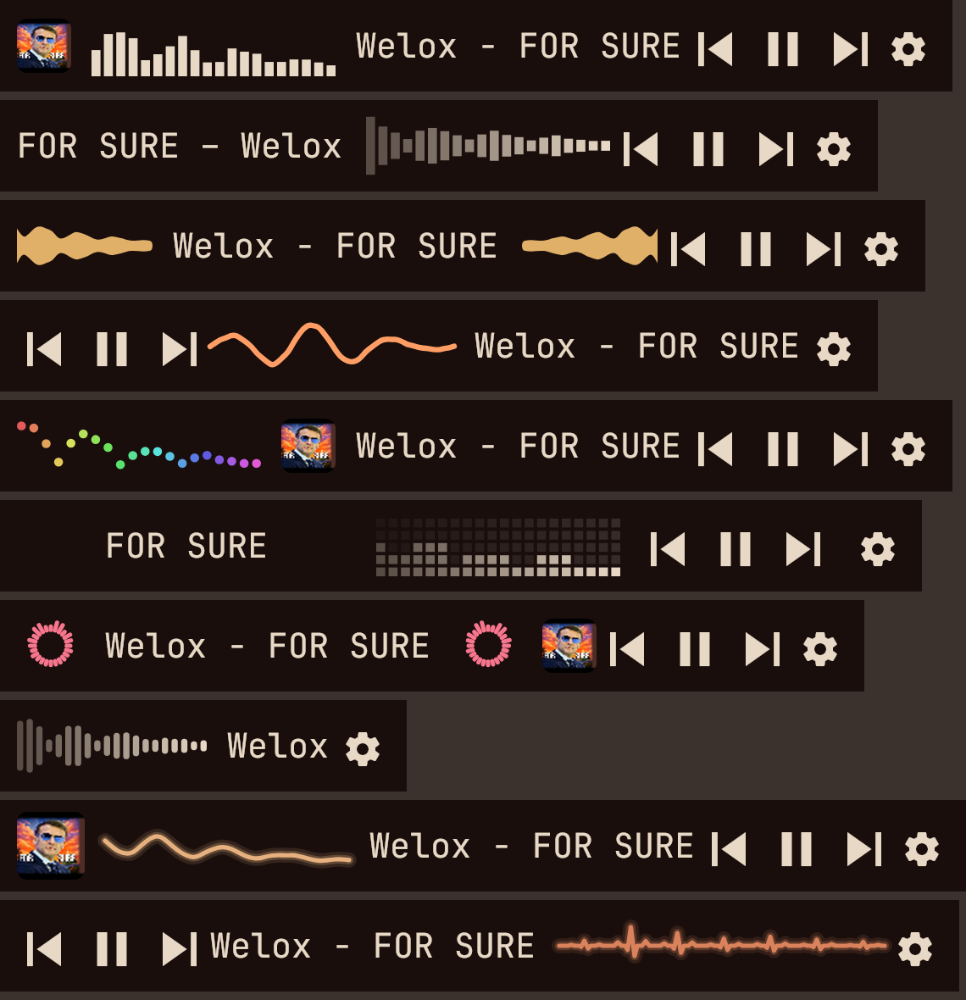
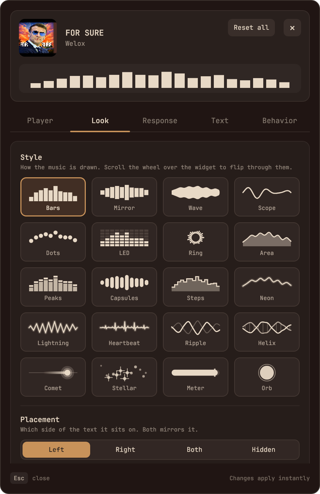
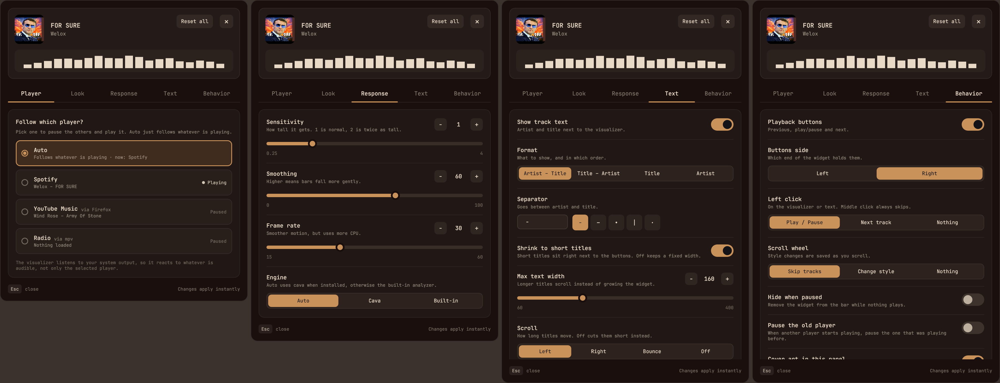

# Omaudix

A now-playing widget for the Omarchy bar: live visualizer, fixed-width scrolling
`artist - title`, and playback controls for any MPRIS player (Spotify, browsers, ...).


## Features

- **24 visualizer styles**: `bars`, `mirror`, `wave`, `scope` (real oscilloscope), `dots`, `led`,
  `ring`, `area`, `peaks`, `capsules`, `steps`, `neon`, `lightning`, `heartbeat`, `ripple`, `helix`,
  `comet`, `stellar`, `meter`, `orb`, `waterfall` (a spectrogram that scrolls down), `fountain`
  (sparks thrown up by each band), `vinyl` (a turning record with the spectrum round its rim) and
  `skyline` (a city whose windows light up with the music).
- **11 color modes**: theme, fade, rainbow, custom, a gradient between two colors, your theme's
  palette, your window border's gradient, colors taken from the song's cover, heat (blue when quiet,
  red when loud), pulse (the accent flaring on the beat) and duotone.
- **Upside down, mirrored or both**: each side's visualizer has its own orientation, so with both
  sides showing they can face each other, hang from the top, or any mix of the two.
- **Round covers that spin**: the cover can be square or round, and a round one turns like a record
  while the music plays, to the left or to the right.
- **Settings panel colors**: the settings panel itself can `theme` (bring your Omarchy theme's
  accent and background into the panel), use a `custom` accent hex, or stay `monochrome` (neutral grey).
  Text always follows the bar foreground. If the shell exposes no theme accent, `theme` looks like `monochrome`.
- **Position**: visualizer on the `left`, `right`, `both` sides (mirrored) or `hidden`.
  Controls can sit on either end too.
- **Capped-width text**: titles that fit are shown at their own width (buttons sit right next to
  them; turn off `compactText` for a fixed width). Text that does not fit scrolls `left`, `right`, `bounce`s, or is truncated (`off`). Speed and the
  rest time before each scroll are adjustable. Text that fits can be left/center/right aligned.
- **Text format**: `artist - title`, `title - artist`, title only, artist only, custom separator (up to 5 characters).
- **Spectrum engine**: uses `cava` if installed, otherwise a built-in FFT (about 3% of one
  core at 30 fps). The scope style always uses its own capture.
- **Tuning**: sensitivity, smoothing, frame rate, band count.
- **Interactions**: left click (play/pause, next, or nothing), middle click next, mouse
  wheel skips tracks *or* cycles the visualizer style live.
- **Player switcher**: the settings panel lists every MPRIS player (Spotify, YouTube Music in a
  browser, cliamp, radio apps...) with what each is playing. Picking one pauses the others and plays it; keep
  `Auto` to just follow whatever is playing. Players that all call themselves "mpv" (or a browser)
  are told apart from their track URL / cover art (YouTube Music, Spotify, Radio, Local file...);
  `omarchy-shell io.github.qempexe.omaudix status` shows each player's `url` if one is not recognised.
- **Cover on the bar** (optional): the song's cover, or a note icon when there is none, placed
  `left` (before everything), `center` (right before the text) or `right` (after everything).
- **Follows external changes**: when another player starts playing, Omaudix switches to it. Turn on
  `pauseOthers` to also pause whichever player was playing before (off by default).
- **Settings stay put**: every change made in the settings panel is saved to
  `~/.local/state/omarchy-omaudix/settings.json` and restored after a shell restart, logout or reboot.
  Only the panel's **Reset all** button (or deleting that file) brings the defaults back.
- **Looks**: twelve ready made ones with undo, twelve places for your own, export and import as JSON.
- Horizontal and vertical bars, multi-monitor safe (one shared audio helper).
- The audio helper only runs while something is playing and the visualizer is visible.

## Showcase

### Bar combinations

Every style, color mode, cover and placement can be mixed. A few of the many combinations:



... and many, many more combinations!

### Settings panel

Seven tabs: **Looks**, **Player**, **Visual**, **Colors**, **Text**, **Cover** and **Behavior**. Every change applies at once and is saved. The search box looks through every tab (Ctrl+F), and **Changed only** lists what differs from the defaults.

**Looks** holds twelve ready made looks, one step of undo, and twelve places for looks of your own. A look covers the visual, its colors, the text and the cover; the player and the mouse settings stay as they are. Saved looks live in `looks.json`, so **Reset all** never touches them.

Under **Player** and **Behavior** there are login options: start on Auto or keep the last player, start playing once the shell is up, and start every session in one of your saved looks.





## Requirements

- [Omarchy](https://omarchy.org) with its Quickshell-based bar
- PipeWire (`pw-record`) and Python 3, used by the built-in spectrum engine and the scope
- Wayland, with `wl-clipboard` (`wl-paste`) and coreutils `timeout`, used for pasting into the settings text fields
- Optional: [cava](https://github.com/karlstav/cava) for its spectrum engine (install it with your package manager)

## Install

Directly from the repo (no scripts):

```
omarchy plugin add https://github.com/qempexe/omarchy-omaudix.git --enable
```

Or manually, from a local copy of this folder:

```
mkdir -p ~/.config/omarchy/plugins/io.github.qempexe.omaudix
cp -r ./. ~/.config/omarchy/plugins/io.github.qempexe.omaudix/
omarchy plugin validate ~/.config/omarchy/plugins/io.github.qempexe.omaudix
omarchy plugin enable io.github.qempexe.omaudix --section left     # or center / right
```

The widget is always visible once placed. With nothing playing it shows an idle
"Nothing playing" label; enable **Hide when paused** if you want it gone instead.
You can also move it with
`omarchy bar move io.github.qempexe.omaudix --section left`.

Remove: `omarchy plugin remove io.github.qempexe.omaudix`.

Optional: install cava for its spectrum. Without it the built-in engine is used.

## Settings

All of these appear in Omarchy's widget settings UI.

| Setting | Values | Default |
| --- | --- | --- |
| `vizStyle` | bars, mirror, wave, scope, dots, led, ring, area, peaks, capsules, steps, neon, lightning, heartbeat, ripple, helix, comet, stellar, meter, orb, waterfall, fountain, vinyl, skyline | bars |
| `vizSide` | left, right, both, hidden | left |
| `vizWidth` | 24-240 px | 72 |
| `barCount` | 6-64 | 20 |
| `colorMode` | theme, fade, rainbow, custom, gradient, palette, border, cover, heat, pulse, duotone | theme |
| `customColor2` | hex, where the gradient ends | #f7768e |
| `vizLeftOrient` | normal, flipped, mirrored, turned | normal |
| `vizRightOrient` | auto, normal, flipped, mirrored, turned | auto |
| `coverShape` | square, circle | square |
| `coverSpin` | off, left, right | off |
| `customColor` | hex like `#7aa2f7` | #7aa2f7 |
| `panelColor` | theme, custom, monochrome (colors of the settings panel) | theme |
| `panelCustomColor` | hex like `#7aa2f7` (used when `panelColor` is custom) | #7aa2f7 |
| `sensitivity` | 25-400 (100 = normal, shown as 1.00) | 100 |
| `smoothing` | 0-100 | 60 |
| `fps` | 15-60 | 30 |
| `engine` | auto, cava, builtin | auto |
| `player` | auto or a D-Bus name (pick it in the panel) | auto |
| `showText` | true / false | true |
| `textFormat` | artist-title, title-artist, title, artist | artist-title |
| `separator` | up to 5 characters | ` - ` |
| `compactText` | true / false | true |
| `textWidth` | 60-400 px (maximum) | 160 |
| `scrollDirection` | left, right, bounce, off | left |
| `scrollSpeed` | 10-120 px/s | 35 |
| `scrollPause` | 0-5000 ms | 1500 |
| `textAlign` | left, center, right | left |
| `showControls` | true / false | true |
| `controlsSide` | left, right | right |
| `hideWhenPaused` | true / false | false |
| `pauseOthers` | true / false | false |
| `coverSide` | hidden, left, center, right | hidden |
| `coverSize` | 10-36 px | 16 |
| `clickAction` | playPause, next, none | playPause |
| `wheelAction` | track, style, none | track |
| `showAlbumArt` | true / false (cover in the settings panel header) | true |

Pasting into the settings text fields (separator, custom colors) reads at most 1024 bytes of the
clipboard through `wl-paste`, so a very large clipboard cannot stall the shell. Native paste is off
in those fields: use Ctrl+V or Shift+Insert, which go through the same capped read. The separator
is limited to 5 characters for typed and pasted input.

Inline form in `~/.config/omarchy/shell.json`:

```json
{ "id": "io.github.qempexe.omaudix", "vizStyle": "ring", "vizSide": "both", "scrollDirection": "bounce" }
```

## Shell commands

```
omarchy-shell io.github.qempexe.omaudix status       # JSON: media, helper state, last error
omarchy-shell io.github.qempexe.omaudix look neon    # a ready made look (classic, studio, neon, mirror, waves, pulse,
                                                     #   cosmos, orbit, comet, scope, helix, minimal)
omarchy-shell io.github.qempexe.omaudix nextLook     # the next ready made look
omarchy-shell io.github.qempexe.omaudix undo         # back to before the last look
omarchy-shell io.github.qempexe.omaudix save 3       # keep the current look in place 3 (1 to 12)
omarchy-shell io.github.qempexe.omaudix saveNew      # keep it in the first free place
omarchy-shell io.github.qempexe.omaudix load 3       # and wear it again
omarchy-shell io.github.qempexe.omaudix exportLook   # the current look as one line of JSON
omarchy-shell io.github.qempexe.omaudix importLook '{"vizStyle":"ring","colorMode":"rainbow"}'
omarchy-shell io.github.qempexe.omaudix set vizWidth 96   # any setting, checked like the panel does
omarchy-shell io.github.qempexe.omaudix cycleStyle   # next visualizer style (until shell restart)
omarchy-shell io.github.qempexe.omaudix resetStyle
omarchy-shell io.github.qempexe.omaudix restart      # restart the audio helper
omarchy-shell io.github.qempexe.omaudix playPause | next | previous
```

## How it works

```
qml/Service.qml        -- reads the active MPRIS player (Quickshell.Services.Mpris), owns ONE helper process
helper/viz.py          -- cava (or built-in FFT over pw-record) / oscilloscope -> one text frame per line
qml/BarWidget.qml      -- layout, settings, clicks
qml/bar/               -- Controls, Cover, MarqueeText, Visualizer
qml/js/visuals/        -- one file per visualizer style
qml/js/colors/         -- one file per color mode
qml/panel/             -- SettingsPopup, SettingRow, LooksPage: the settings panel
qml/js/Schema.js       -- every setting: tab, options, default; the ready made looks
qml/core/SettingsStore -- the saved overrides
```

The visualizer reacts to your **system output** (default sink monitor), not to one specific
player stream, and runs only while the selected player is playing. If a game or a second
app is making sound at the same time, it will show up in the visualizer as well.

## Tests

```
python3 tests/test_viz.py        # helper: FFT bands, scope, pacing, fake pw-record end to end
python3 tests/test_manifest.py   # manifest vs. QML settings drift
node tests/test_parts.js         # every visual and color mode, drawn at many sizes
```

## Adding a visual or a color mode

Each one is a single file. [CONTRIBUTING.md](CONTRIBUTING.md) walks through it.


## Credits and thanks

- Inspired by **WaveBar**, the idea of a now-playing bar widget with a live visualizer.
- Thanks to the **Omarchy** project for the shell and plugin system this runs on.
- Thanks to **Quickshell** and **Qt** for the toolkit the widget is built with.
- Thanks to **PipeWire** for the audio capture, and to **cava** for its spectrum engine.
- Thanks to that banger song :)
- Thanks to everyone who tests it and reports issues.

## Disclaimer

Omaudix is an independent project. It is not affiliated with or endorsed by Omarchy,
WaveBar, Spotify, YouTube Music or any other service or player mentioned here; those names
are used only to describe what the widget can follow. Cover art is shown from the address
the player provides and is never stored or redistributed.

## License

MIT
